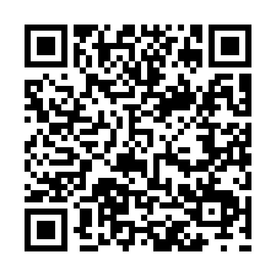

# SonyLanguageUnlock

[中文](README.md) | English

[☕ Buy me a coffee: WeChat Pay / Alipay / USDT (BSC)](#support)

A Windows desktop language tool for Japanese-market Sony cameras. Switch between Chinese and English in the top-right selector. The desktop language is independent from the option that enables Chinese on the camera.

**Writing is currently limited to ILCE-7CM2, firmware 2.01, Japanese J1 configuration.** The new product name does not imply support for every Sony camera. Detection can attempt model/version queries on other Sony MSC cameras, but compatibility with those devices remains unverified. Successful detection does not authorize writes.

## Usage

Extract the complete Windows ZIP, keep `_internal` beside the executable, and run `SonyLanguageUnlock.exe`. Python is not required.

**Starting with 0.3.2, both normal MSC and service mode use WinUSB.** Follow the Zadig setup below first. Upgrading from 0.3.1 requires replacing the normal interface's libusb-win32 binding with WinUSB.

- Turn on the camera, select Mass Storage / MSC, close other camera software, and connect only one camera. Click **Detect camera** to read its model and firmware version.
- Leave **Unlock Chinese** unchecked to enable other languages and disable both Chinese options. This mode does not read firmware packages or fonts.
- To enable Chinese, select the checkbox and your official `BODYDATA.DAT`. The app displays the package model/version. **Replace firmware…** selects a different local file; it does not flash or update the camera.
- A model/version mismatch blocks unlocking. Selecting Chinese without a valid package prompts you to choose one. Only the reviewed ILCE-7CM2 / 2.01 package is accepted for writes.
- Click **Start unlock**. The app queries the camera again and binds the operation to the same body, then applies the language settings and selected font restoration. Maintain USB connection and power.
- Disconnect USB, power the camera off and on, and check the language menus. Reconnect in MSC mode, tick the restart confirmation, then click **Read-only check after restart**.

## Zadig driver setup

Verified ILCE-7CM2 IDs: normal MSC **054C:0E8A**, service mode **054C:0336**. Both require WinUSB in 0.3.2; do not assume these IDs apply to every Sony model. Close camera tools, connect only the target camera in MSC mode, and record the previous driver.

Run [Zadig](https://zadig.akeo.ie/) as administrator. Enable **Options → List All Devices**, select the exact camera USB ID, choose **WinUSB**, and click **Replace Driver / Install Driver**. Repeat for the service interface when visible; skip an interface already using WinUSB. Avoid hubs, composite parents, and unrelated IDs. See the [official guide](https://github.com/pbatard/libwdi/wiki/Zadig). Installation may require driver trust prompts and device-package certificates; this app does not install drivers or certificates itself.

If only 0E8A appears, the camera is in normal mode. Detection requests the service transition. For first-time setup before the service interface appears, Zadig's advanced **Device → Create New Device** can prepare WinUSB for VID **054C**, PID **0336**, without inventing an MI value. An existing conflicting driver may still need replacement when visible. This preinstallation route has not been tested on a clean Windows installation by this project.

Close Zadig, disconnect USB, restart the camera, reconnect MSC, and use **0.3.2 or later** to detect. Success requires valid model/version and normal USB return. Version 0.3.1 expects libusb0 for normal mode and is not suitable for this configuration.

Replacing MSC may affect card access and official software. To restore access, verify the hardware ID in Device Manager and use driver rollback if available; otherwise follow [Zadig's recovery instructions](https://github.com/pbatard/libwdi/wiki/FAQ#help-zadig-replaced-the-driver-for-the-wrong-device-how-do-i-restore-it) to remove the replacement device/driver package and reconnect. This tool may then need WinUSB rebound.

## Checks and limitations

The workflow uses 35 reviewed language properties. Non-Chinese mode enables the other 33 and disables Simplified and Traditional Chinese. Chinese mode restores the original property protection before restoring two LTT fonts and the shared icon TTF. Exact existing matches are skipped; differing files are not overwritten.

The official 2.01 DAT is 1,139,929,560 bytes, SHA-256 `eb4943e6099754d64deaef5047942e9bfe258f232d0b7bc39fa23b3cd10e1e31`. Target font hashes are documented in [the Chinese README](README.md). Package identification uses content, never its filename. Unknown parseable DAT packages may be inspected but are not automatically approved for writing.

ILCE-7CM2 detection temporarily enters service mode to read only the firmware version file and body configuration for identity checking, then returns to normal USB. A read-only guard blocks settings and font writes. It sends no firmware update commands. Service sessions are spaced at least 30 seconds apart. Other models use model information and version-query initialization/queries. Before writes, the application rechecks model, version, and body identity; service mode verifies identity, firmware, and region again. No explicit ID1 command, shared-library patch, shell, arbitrary file write, or delete interface is exposed.

Records are stored under `%LOCALAPPDATA%/SonyLanguageUnlock`. Existing `%LOCALAPPDATA%/A7C2LanguageTool` records remain in use after upgrading so pending operations cannot be bypassed by the rename. Do not publish private camera snapshots or remove pending markers to retry uncertain writes. Post-restart verification can resume without selecting the firmware package again.

Both Windows interfaces use WinUSB through bundled libusb1. System libusb0.dll is no longer required, and there is no automatic libusb-win32 backend fallback. The app does not install drivers or certificates, and does not retry failed commands through another backend. Current write-profile USB IDs are `054C:0E8A` and `054C:0336`.

The 0.3.2 read-only detector passed on an ILCE-7CM2 / 2.01 with both interfaces using WinUSB: model, version, and body identity were read, normal USB returned, and no settings or file writes were attempted. All 61 offline tests passed. **The complete GUI unlock/write workflow remains untested, and one successful detection does not establish reliability across all connection states.** Earlier manual restoration success was reported by the owner. Persistence after firmware updates remains untested. Controls, workflow prompts, and normal progress messages are bilingual; unmapped low-level technical errors retain their original text and are labelled accordingly.

## Development

Use Windows x64 and Python 3.12 with tkinter:

```powershell
python -m pip install -r requirements-dev.txt
python -m pytest -q
python app.py --self-test ui-check.json
./build.ps1 -Python python
python dev/package_release.py
```

Tests prohibit USB enumeration and use synthetic camera data. Packages exclude firmware, Sony fonts, build caches, and private camera snapshots. See [validation](VALIDATION.md), [font research](FONT_COMPARISON.md), [third-party components](THIRD_PARTY.md), and [GitHub publishing instructions](GITHUB_UPLOAD.md).

## Support

If this project helped you, consider buying me a coffee ☕. Support is optional and does not unlock features or guarantee paid services or compatibility.

| WeChat Pay | Alipay | USDT · BSC (BEP20) |
|:---:|:---:|:---:|
| <a href="assets/sponsor/wechat.jpg"></a> | <a href="assets/sponsor/alipay.jpg"></a> | <a href="assets/sponsor/usdt-bsc.png"></a> |

Click an image for the original. Confirm the recipient before paying through WeChat or Alipay.

**USDT receiving address — BSC / BEP20 only:**

```text
0x13be5b77a05bdff880a6cc4f909dc9ae68a58908
```

**The QR code contains the address only; it does not select the token or network. Manually select USDT and BNB Smart Chain (BSC / BEP20), and verify the full address.** Binance's current minimum deposit and deposit availability requirements apply.

[Full sponsorship details / 完整赞助说明](SPONSOR.md)
